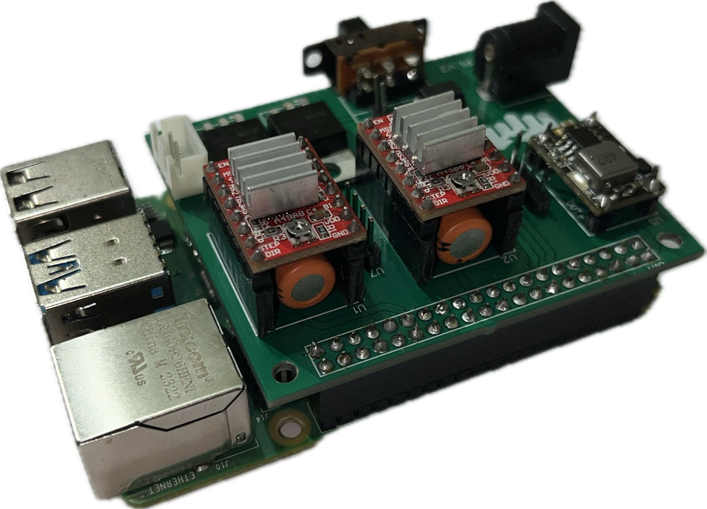

# Automated 3D Optical Scanner (MeshMapper)

An automated photogrammetry turntable and optical acquisition rig built on a Raspberry Pi 4B host[cite: 24]. The platform synchronizes physical angular stepping of a high-torque mechanical turntable and curved camera gantry with an Arducam IMX519 autofocus camera module over MIPI CSI-2, generating structured 360-degree image datasets for photogrammetric mesh generation[cite: 1, 24].

## Live System Demonstration


*(If the inline player above does not render, click [`3D scanning system.mp4`](3D%20scanning%20system.mp4) in the repository file tree to view the full hardware capture run and mesh comparison.)*

## Engineering Scope & Hardware Contributions

* **Dedicated Custom Interface & Power PCB (`MM Pi V2`):** Designed and routed a custom 2-layer Raspberry Pi HAT (`65.4 mm × 56.1 mm`) in EasyEDA from reference schematics to eliminate loose breadboard wiring[cite: 10, 13, 24]. Resolved electrical noise and inductive kickback by isolating high-current `12V` motor driver traces from the clean `5V`/`3.3V` logic power delivery feeding the Raspberry Pi and camera sensor[cite: 24].
* **Electromechanical Stage Integration:** Assembled and calibrated a precision stepper-driven turntable and curved gantry indexing mechanism to achieve consistent angular steps without angular overshoot or drift[cite: 1, 24].
* **Firmware & Capture Synchronization:** Adapted and modified Python automation routines to sequence turntable motor stepping, settle physical vibrations, and trigger exposure capture on the Arducam IMX519 via `libcamera` without motion blur[cite: 24].
* **3D Point-Cloud Pipeline:** Integrated open-source photogrammetry reconstruction workflows to process exported 360-degree image batches into point-clouds and 3D surface meshes (`.OBJ`/`.STL`)[cite: 24].

## Custom Hardware Architecture (`MM Pi V2` Pi HAT)

* **Dual Stepper Drive:** Two socketed **A4988** stepper drivers (`U1`, `U2`) with local bulk electrolytic decoupling capacitors directly beneath the headers to absorb inductive current transients[cite: 1, 3].
* **Isolated Power Stage:** Dedicated DC barrel input and physical power switch feeding an onboard buck converter (`U5`, `4.7 µH` inductor) and linear regulation (`U3`), separating `12V` actuator supply from regulated `5V`/`3.3V` logic rails[cite: 1, 3].
* **Auxiliary Load & Camera Interface:** Dual **IRFZ44N** low-side N-channel power MOSFETs (`Q1`, `Q2`) for PWM ring-light control, external camera trigger interface, and broken-out Raspberry Pi GPIO headers[cite: 3, 23].
* **2-Layer Routing & DFM:** Full top and bottom copper ground pours, `1.25 mm` power traces vs. `1.00 mm` signal routing, and milled plated slots (`G85`) for mechanical reinforcement on the barrel jack and slide switch[cite: 12, 14, 17].

### Fabricated Hardware, Schematic & 2-Layer Routing

| System Schematic | Assembled Pi HAT | Top Component Layout |
| :---: | :---: | :---: |
|  |  |  |

| Top Copper Layer | Bottom Copper Layer | 3D PCB Render |
| :---: | :---: | :---: |
|  |  |  |

## System Architecture

```text
+-------------------------------------------------------------------+
|                   Power Distribution (Custom PCB)                 |
|                                                                   |
|  [ External 12V Supply ] ---> [ Stepper Motor Driver Rail (12V) ] |
|                          |                                        |
|                          +--> [ Regulated Logic Rail (5V) ]       |
+-------------------------------------------------------------------+
                                 |
                                 v
+-------------------------------------------------------------------+
|                  Host Controller (Raspberry Pi 4B)                |
|                                                                   |
|  [ Python Orchestration Script ]                                  |
|     |                                                             |
|     +--- GPIO Stepping Control ---> Stepper Drivers (A4988)       |
|     |                               - Turntable & Arc Indexing    |
|     |                                                             |
|     +--- MIPI CSI-2 Pipeline -----> Arducam IMX519 (16MP)         |
|          (libcamera / V4L2)         - Vibration-Settled Capture   |
+-------------------------------------------------------------------+
                                 |
                                 v
                        Output Artifacts
                   Structured 360° Image Batches
             Downstream Photogrammetry Engine (.OBJ / .STL)
